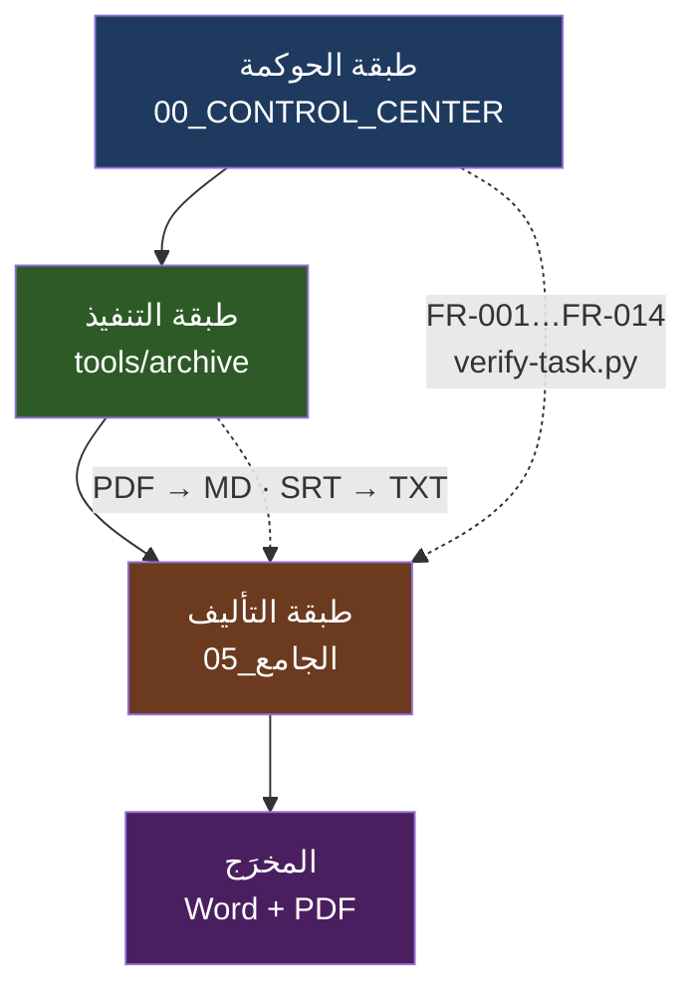
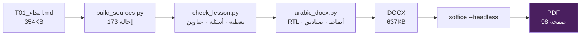

# الفصل الأول — الرحلة الكاملة

> من أول جولة تنظيف في أغسطس إلى كتاب مطبوع في أكتوبر: ماذا حدث، بأي ترتيب، وبأي ثمن.

---

## المحتويات

1. [لماذا نحكي الرحلة](#١-لماذا-نحكي-الرحلة)
2. [الخريطة الزمنية](#٢-الخريطة-الزمنية)
3. [الطبقات الثلاث](#٣-الطبقات-الثلاث)
4. [تطوّر الأرقام](#٤-تطوّر-الأرقام)
5. [من PDF إلى نص](#٥-من-pdf-إلى-نص)
6. [من نص إلى درس جامع](#٦-من-نص-إلى-درس-جامع)
7. [من درس إلى كتاب مطبوع](#٧-من-درس-إلى-كتاب-مطبوع)
8. [الثمن: ما ضاع وما استُعيد](#٨-الثمن-ما-ضاع-واستُعيد)
9. [خلاصة الفصل](#٩-خلاصة-الفصل)

---

## ١. لماذا نحكي الرحلة

لأن الفصول التالية تشرح **كيف يعمل النظام**، وهذا الفصل يشرح **كيف وصلنا إليه**. والفرق مهم: النظام الذي تراه اليوم ليس تصميمًا على ورق، بل نتيجة سلسلة أزمات حقيقية — فقد ملفات، وقتل عمليات، وفشل حصص، وتدهور جودة — كل واحدة منها غيّرت قرارًا في التصميم.

قراءة الرحلة تعطيك شيئًا لا تعطيه قراءة الكود: **معرفة أي قرار جاء ردَّ فعل وأي قرار جاء تفكيرًا مسبقًا**. الأول يحتاج مراجعة، والثاني يحتاج احترامًا.

---

## ٢. الخريطة الزمنية

### ٢.١ قبل المشروع: أغسطس 2026

| التاريخ | الحدث | المشكلة | الإجراء |
|---|---|---|---|
| 2026-08-24 | جولة تنظيف أرشيفية مبكرة | أسماء ملفات تالفة بمحارف `U+FFFD` في الفقه والحديث والتفسير؛ ملفات مكررة بايت-ببايت؛ سكربتات توليد قديمة | نقل `gen_*` و`build_tawheed` إلى `zone/old_scripts`؛ إعادة تسمية الملفات بالعنوان الحقيقي المستخرج من داخل الكتاب؛ حذف المكرر بعد مطابقة `md5`؛ تنظيف المحارف التالفة |

هذه الجولة لم تكن جزءًا من المشروع، لكنها تركّز النمط الذي سيتكرر لاحقًا ثلاث مرات: **الاسم لا يُوثق به — يُستخرج من داخل الملف**.

### ٢.٢ الجولة الأولى: التأسيس (2026-10-21)

| البند | التفصيل |
|---|---|
| الناتج | 12 ملف تحكم + 8 أدوات + جرد أولي + خريطة منهج |
| المشكلة | لا سجلات ولا معرّفات ثابتة؛ قراءة المنهج يدويًا (470 سطرًا)؛ «الفهرس» كان يُحسب درسًا فيولّد 21 درسًا وهميًا |
| الحل | `inventory.py` بـ32 عمودًا · `curriculum.py` (18 مادة · 61 وحدة · 51 فرقة · 470 درسًا · 14 كتابًا) · حارس `in_index` يمنع عدّ الفهرس درسًا · 30 وكيلًا بدل 23 |

### ٢.٣ الجولة الثانية: الاستخراج والتحقق

| البند | التفصيل |
|---|---|
| المشكلة الأولى | عدّ الملفات على NTFS/FUSE متذبذب (37 ألفًا ↔ 46 ألفًا) |
| المشكلة الثانية | قائمة لغات الترجمة 100+ لغة ⇒ 57 استخراجًا فاشلًا |
| المشكلة الثالثة | OCR تلقائي يستهلك 70 دقيقة معالج بلا أي فائدة |
| المشكلة الرابعة | منطق `is_english_subject` معكوس |
| الحل | الاعتماد على `SHA-256` لكل ملف + عدّ ثلاثي؛ فلترة اللغات إلى `ar,ar-orig,en,en-orig`؛ OCR اختياري `--ocr`؛ إصلاح المنطق؛ حدّ زمني لملف الجرد؛ `make check` 11/11 |

النتيجة الرقمية: 37,231 ملفًا مبصومًا · 3,989 مجموعة تكرار · 675 فيديو · 497 تفريغًا · تغطية 58%.

### ٢.٤ الجولة الثالثة: قرارات المستخدم

هنا وُلد القرار الذي يحكم كل ما بعده:

> **ممنوع: لا OCR محلي.**

السبب موثّق: `tesseract` و`paddleocr` على أغلفة عربية مزخرفة يُنتجان أدلة إصدار مشوّهة — والأسوأ أنهما يُنتجان **نصًا يشبه الصحيح**، وهو خطر أكبر من الفشل الصريح.

| البند | التفصيل |
|---|---|
| البديل | `find_user_text()` يستقبل نص المستخدم بصيغ `.txt/.md/.docx` |
| المشكلة الثانية | التفريغات فيها تكرار متدحرج (نوافذ متراكبة من yt-dlp) |
| الحل | `subtitle_clean.py` بمقارنة **ذيل النص** (`append_new`) لا بالـcue السابق |
| النتيجة | 876 ملفًا · 50.9 مليون حرف · الحجم 109.5MB ← 73.6MB · الأصل محفوظ في `_raw/` |

### ٢.٥ الجولة الرابعة: الحصر الشامل والتسمية

| البند | التفصيل |
|---|---|
| المشكلة | 1,384,235 فيديو بلا علاقة بالمنهج |
| المشكلة الأخطر | تصادم أسماء التفريغات أفقد **494 ملفًا** |
| المشكلة الثالثة | مجلد `_raw/_raw/` متداخل |
| الحل | 639 استعلامًا · 8,036 فيديو · 2,364 قناة · 60,165 قائمة؛ ترشيح بمفردات المنهج؛ ترتيب ثابت بـ`video_id` + لاحقة `__2` عند التعارض؛ **استرجاع ذاتي** من `_raw/` أنقذ 542 ملفًا متحققًا؛ DownSub نجح في 48 من 57 |

**الدرس**: أي نظام يسمّي ملفات بمفتاح غير فريد سيُفقد ملفات. الحل لم يكن يدويًّا بل قاعدة تسمية.

### ٢.٦ استعادة ما حُذف (2026-10-21)

| ما ضاع | أين وُجد | كيف استُعيد |
|---|---|---|
| 7 ملفات فيزياء (ترجمات الفصول 5–8 + `clean_subs.py`) | `Trash-1000` | نسخ لا نقل |
| ملخصان (إنجليزي وكيمياء) | سلة المستخدم | نسخ |
| `Activity_Simulator` (17,907 ملفًا/177MB) | `~/.local/share/Trash` | نسخ إلى `~/Projects/` |
| `محاكي_النشاط` (6,666 ملفًا/82MB) | السلة | نسخ إلى `~/Projects/` |

القاعدة المستخلصة هنا: **لا تحذف من السلة قبل أن تُثبت أن المحتوى موجود في مكان آخر بنفس البصمة.**

### ٢.٧ الجولة الخامسة: 6 وكلاء متوازيين (2026-10-22)

| البند | التفصيل |
|---|---|
| العائق | `books2docx` معطّل (BLK-07): يطبع «Starting Server» ويخرج في 0 ثانية ⇒ 69 كتابًا و10,981 صفحة بلا استخراج |
| العائق الثاني | حصة Gemini الحقيقية: **20 طلبًا/يوم/موديل** لا 1500 |
| العائق الثالث | مُطابِق العناوين يُسند الفيديو لكل الدروس: 1,737 صفًا مقابل 135 فيديو فقط |
| الحل | بديل `pdftotext` لـ110 ملفات · بناء `gemini_ocr.py` على مفتاح مجاني · تدوير 15 موديلًا (~300 طلب/يوم) · إصلاح ثلاثي لـ`yt_rank.py` (تداخل شرط + أرقام حاكمة + نسبة ≥50%) |

### ٢.٨ جولة «الإغلاق الكامل» (2026-10-23)

| البند | التفصيل |
|---|---|
| المشكلة | 200 كتابًا ← 121 سليمًا · 78 مشبوهًا · 1 فارغ؛ 162 درسًا ضعيف التغطية من 441؛ لا نسخة احتياطية كاملة |
| الحل | `QUALITY_AUDIT` · `arch-reconvert@0/1` لـ79 كتابًا · `WEAK_COVERAGE` · `NEAR_DUPLICATES` (23 زوجًا) · `BACKUP_RESTORE_TEST` ناجح مع توثيق الفجوة |

### ٢.٩ إصلاح البرومبت (2026-10-23)

أهم اكتشاف في تاريخ الخط: **31.6% من الصفحات (986 من 3,116) بلا نسخ حرفي كامل**. النموذج لم يكن يفشل، كان **يصف** الصفحة بدل نسخها — والبرومبت القديم كان يسمح بذلك ضمنيًّا.

الحل: برومبت حرفي جديد (1,242 حرفًا) يفرض النسخ، وخدمات `systemd` دائمة `arch-gemini@0` و`arch-reconvert@0/1`.

### ٢.١٠ نجاح إعادة التحويل — والفخّ (2026-10-24)

| البند | التفصيل |
|---|---|
| الفخّ | النسخ الاحتياطي `.md.bak` كان يُنشأ **قبل** التحويل ⇒ عند الفشل يمسح الأصل ويُبقي الفراغ |
| الثمن | 3 كتب فُقدت |
| الإصلاح | النسخ الاحتياطي عند **النجاح فقط** |
| النتيجة | `arch-reconvert@0` 25/27 · `@1` 26/26 · `@2` 26 كتابًا · الكتب بلا نص: 12 ← 8 |

### ٢.١١ بناء سلسلة «الجامع» (2026-10-27)

| البند | التفصيل |
|---|---|
| المشكلة | لا تقارير Markdown في `state/`؛ `00_الإدارة/الحالة.md` تصف نفسها: «الآن: هيكل فقط» وكل مراحل الاستخراج والتأليف أصفار |
| الحل | الخريطة الكبرى (18/101/437) · تسوية الخريطة (17 مادة مطابقة + 1 تحتاج مراجعة يدوية) · 4,860 مهمة و10 مراحل و9 قوالب |

---

## ٣. الطبقات الثلاث

المشروع ليس طبقة واحدة، ومعرفة الطبقة التي تُصلح فيها الخلل هي نصف الحلّ.

| الطبقة | ماذا تفعل | أين تسكن | علامة الخلل فيها |
|---|---|---|---|
| الحوكمة | تُعرّف «ما المطلوب» وتقيسه | `00_CONTROL_CENTER/` | متطلب بلا دليل، أو دليل بلا متطلب |
| التنفيذ | تُنتج المادة الخام | `tools/archive/` + خدمات `arch-*` | ملف موجود لكنه فارغ أو مشوّه |
| التأليف | تحوّل الخام إلى كتاب | `tools/jamea/` + `05_الجامع/` | درس طويل لكنه لا يجيب عن المنهج |

**قاعدة تشخيصية**: إذا كان النص رديئًا فالمشكلة في الطبقة الثانية. إذا كان النص سليمًا والكتاب لا يغطي المنهج فالمشكلة في الثالثة. إذا كان الاثنان سليمين والسجل يقول غير ذلك فالمشكلة في الأولى.

---

## ٤. تطوّر الأرقام

واحدة من أكبر مشكلات المشروع أن الأرقام تغيّرت في كل جولة، وكُتبت في أماكن مختلفة بلا تاريخ قياس. هذا الجدول يجمعها لأول مرة في مكان واحد:

| المقياس | الجولة 1 | الجولة 2 | الجولة 5 | النهائي (2026-10-27) |
|---|---:|---:|---:|---:|
| الدروس | 470 | 470 | 441 | **437** |
| الوحدات | 61 | 61 | — | **101** |
| المواد | 18 | 18 | — | **18** |
| المصادر المسجَّلة | — | — | 154 | **549** |
| الفيديوهات | — | 675 | 8,036 | 1,000+ |
| التفريغات | — | 497 | 876 | 876 |
| التغطية | 48% | 58% | — | 64% |
| المهام المخطَّطة | — | — | — | **4,860** |

**تحذير صريح**: لا تتعامل مع أي رقم من هذا الجدول كحقيقة نهائية بلا إعادة قياس. الفصل السادس يشرح لماذا هذا التشعّب نفسه مشكلة حوكمة لا مجرد اختلاف تحرير.

---

## ٥. من PDF إلى نص

السبب في تحويل PDF إلى صور أولًا: طبقة النص في الكتب الممسوحة ضوئيًّا إما غائبة أو مشوّهة بترتيب حروف عربي معكوس. الصورة تُجبر النموذج على **القراءة البصرية**، وهي أدقّ بكثير في العربية.

التفاصيل الكاملة — الموديلات، البرومبت، الحصص، عتبات الجودة — في [الفصل الثاني](02-pdf-to-text-pipeline.md).

---

## ٦. من نص إلى درس جامع

الدرس ليس «ملف Markdown كبيرًا». الدرس ست كتل تُبنى مستقلّة ثم تُجمَّع:

| الكتلة | محتواها | لماذا مستقلّة |
|---|---|---|
| `g1` | الإطار العام والتمهيد | لأنها تحدد بنية ما بعدها |
| `g2` | الشرح الأول (الجزء الأول من المسائل) | حجمها يتجاوز سقف النداء الواحد |
| `g3` | الشرح الثاني | نفس السبب |
| `g4` | الشرح الثالث | نفس السبب |
| `g5` | الأمثلة والإعراب | تحتاج تركيزًا مختلفًا عن الشرح |
| `g6` | الأسئلة والتدريبات | تُبنى من الشرح لا معه |

بوّابات الانتقال ليست شكليات:

- `DONE` — علامة إتمام المرحلة.
- **وسم كتلة** — يثبت أن المحتوى كُتب للمرحلة الصحيحة لا نُسخ من غيرها.
- **تغطية** — كل عنوان مطلوب موجود فعلًا.
- **حد أدنى بايت** — يمنع «ملف موجود لكنه فارغ».
- **عدد عناوين مطابق** — يمنع الاختصار الصامت.

القاعدة التي وُلدت من الأزمة: **ملف موجود ليس دليلًا على عمل منجز.** ثلاث مرات في تاريخ المشروع كان الملف موجودًا وفارغًا أو مقطوعًا.

التفاصيل في [الفصل الرابع](04-jamea-factory.md).

---

## ٧. من درس إلى كتاب مطبوع

الأرقام النهائية للدرس النموذجي:

| المقياس | القيمة |
|---|---:|
| الحجم | 354KB |
| الأسطر | 2,507 |
| الكلمات | ~33,012 |
| العناوين `###` | 110 |
| الأقسام الرئيسية | 18 |
| الآيات | 102 |
| صفوف الجداول | 181 |
| صناديق التبسيط | 18 |
| صناديق الفخّ | 33 |
| صناديق التريكة | 37 |
| صناديق التنبيه | 80 |
| صناديق التصحيح | 12 |
| الأسئلة | 199 |
| صفحات PDF | 98 |

التفاصيل في [الفصل الثالث](03-docx-engine.md).

---

## ٨. الثمن: ما ضاع وما استُعيد

لا توجد رحلة هندسية بلا ثمن، وتوثيق الثمن أنفع من إخفائه.

| الحادثة | ما ضاع | هل استُعيد؟ | الدرس |
|---|---|---|---|
| تصادم أسماء التفريغات | 494 ملفًا | نعم — استرجاع ذاتي من `_raw/` | التسمية بمفتاح غير فريد = فقد مضمون |
| `.md.bak` قبل التحويل | 3 كتب | نعم | النسخ الاحتياطي عند النجاح فقط |
| حذف مجلد بلاي ليست | 7 ملفات فيزياء | نعم من السلة | السلة لا تُفرَّغ قبل التحقق من البصمة |
| `bg-reaper` يقتل الجرد | جرد 36,000 ملف | أُعيد التشغيل كخدمة | العمليات الطويلة تُشغَّل كخدمة لا كأمر في القشرة |
| `tmp-cleanup` يمسح المراجع المؤقتة | مرجع أسئلة `before_insert_0922.md` | لا — بقي `.premigrate.bak` | لا تعتمد على `/tmp` كمرجع وحيد |

الدرس الجامع: **كل فقد كان بسبب مورد مشترك بلا مالك واضح** — اسم ملف، أو مجلد مؤقت، أو عملية بلا خدمة.

---

## ٩. خلاصة الفصل

1. المشروع بدأ بجولة تنظيف صغيرة في 2026-08-24، وتحوّل إلى نظام أرشفة كامل بحلول 2026-10-27.
2. الطبقات ثلاث: حوكمة، تنفيذ، تأليف — وتشخيص الخلل يبدأ بتحديد الطبقة.
3. قرار «لا OCR محلي» كان نقطة تحوّل: النص المشوّه أخطر من النص الغائب.
4. الأرقام تغيّرت في كل جولة (470 ← 441 ← 437 درسًا)، والتشعّب نفسه مشكلة موثّقة.
5. كل فقد ملفات في المشروع كان سببه مفتاحًا غير فريد أو نسخة احتياطية في التوقيت الخطأ.
6. خط التحويل مرّ بثلاث أزمات: توقف `books2docx`، حصة 20 طلبًا/يوم، وبرومبت يسمح بالاختصار.
7. إصلاح البرومبت وحده رفع جودة النسخ بعد أن ثبت أن 31.6% من الصفحات لم تكن منسوخة حرفيًّا.
8. مصنع التأليف بُني على بوّابات قرص لا على وعود النموذج.
9. الدرس النموذجي «النداء» أنتج 354KB و98 صفحة و199 سؤالًا بـ173 إحالة مصدر.
10. ما بقي أصعب من ما مضى: تعميم النمط على 436 درسًا بلا فقد جودة.
