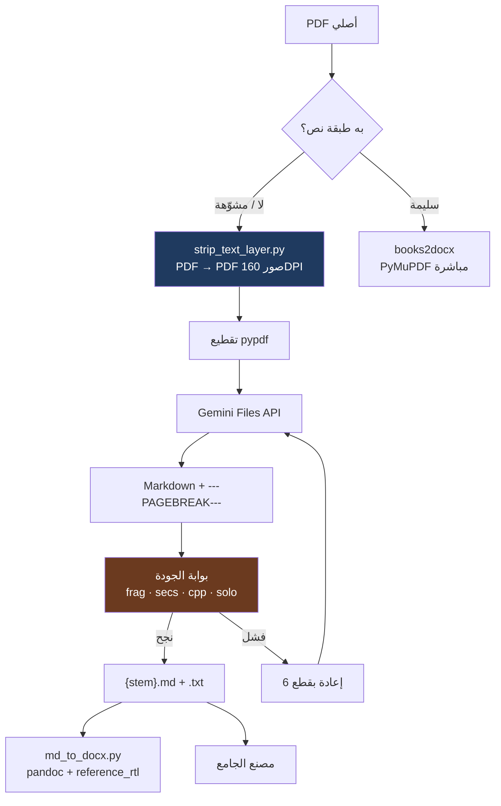

# الفصل الثاني — من PDF إلى نص: خط التحويل

> كيف تتحوّل صفحة ممسوحة ضوئيًّا إلى Markdown عربي حرفي — وما الذي ينكسر في الطريق.

---

## المحتويات

1. [لماذا هذا أصعب خطوة](#١-لماذا-هذا-أصعب-خطوة)
2. [الخطّان لا الخط الواحد](#٢-الخطان-لا-الخط-الواحد)
3. [المعمارية الكاملة](#٣-المعمارية-الكاملة)
4. [الموديلات: الاكتشاف والتدوير والفشل](#٤-الموديلات-الاكتشاف-والتدوير-والفشل)
5. [البرومبت: عقد النسخ الحرفي](#٥-البرومبت-عقد-النسخ-الحرفي)
6. [التقطيع والدقة](#٦-التقطيع-والدقة)
7. [الحصص والمفاتيح و429](#٧-الحصص-والمفاتيح-و429)
8. [الاستئناف وإدارة الحالة](#٨-الاستئناف-وإدارة-الحالة)
9. [قياس الجودة](#٩-قياس-الجودة)
10. [المخرجات والسجلات](#١٠-المخرجات-والسجلات)
11. [ما لم يُحل بعد](#١١-ما-لم-يحل-بعد)
12. [خلاصة الفصل](#١٢-خلاصة-الفصل)

---

## ١. لماذا هذا أصعب خطوة

التحويل هو الحلقة التي لا يمكن تعويضها لاحقًا. كل ما يأتي بعده — التأليف والتنسيق والطباعة — يعمل على النص الناتج، ولا يمكنه أن يستعيد ما ضاع في التحويل. والخطأ هنا **صامت**: النص يبدو عربيًّا سليمًا، لكنه ناقص صفحة، أو مقدَّم فيه وصف الصورة بدل نصّها، أو فيه فقرة أُعيدت صياغتها.

المشكلة العربية تحديدًا مركّبة من ثلاثة عوامل:

| العامل | الأثر |
|---|---|
| ترتيب الحروف في طبقة النص | كثير من PDF العربية تحمل `ToUnicode` معطوبًا فيخرج النص مقلوبًا (`علوم القرآن` ← `آرقلا مولع`) أو مفكَّك التشكيل |
| الأشكال العربية التقديمية | محارف في نطاق `U+FB50`+ لا تطابق الحروف العادية إلا بعد تطبيع `NFKC` |
| الغنى الطباعي | تشكيل، همزات، ألف خنجرية، أرقام هندية، حواشٍ، جداول بلا حدود — كلها تفشل معها أدوات OCR العامة |

ولهذا كان القرار المؤسِّس: **لا OCR محلي**. `tesseract` و`paddleocr` ينتجان على الأغلفة المزخرفة أدلّة إصدار مشوّهة، والأخطر أنهما ينتجان نصًّا **يشبه** الصحيح — فيمرّ بلا اعتراض. والقرار البديل: التحويل عبر Gemini API، بقراءة بصرية للنموذج، مع برومبت يفرض النسخ الحرفي.

---

## ٢. الخطّان لا الخط الواحد

في المشروع خطّان للتحويل، ولا يصلح الخلط بينهما:

| | الخط A: `gemini_ocr.py` + pipelines | الخط B: `books2docx/convert_books.py` |
|---|---|---|
| مكان التعرّف | Google Gemini API مباشرة (Files API) | محلي (PyMuPDF)، أو سيرفر AI Studio Applet عند تشوّه النص |
| وحدة الإدخال | PDF مقطوع (`pypdf`) | PDF مقطوع (`PyMuPDF`) |
| القطع الافتراضي | 60 صفحة (`--chunk`)، والخطوط تستخدم 10 ثم 6 | 12 صفحة (`SERVER_CHUNK_PAGES`) |
| الاستئناف | `*.state.json` على مستوى القطعة | `batch_resume.json` على مستوى الكتاب |
| بوابة الجودة | عتبات إحصائية بعد التحويل | كشف «نص مشوّه» قبل الاختيار، **بلا بوابة بعد التحويل** |
| المخرجات | `.md` + `.txt` + DOCX عبر pandoc | `.md` + `.txt` + `.docx` + ZIP |
| الحالة | مستخدم فعليًّا في المشروع | أداة قديمة/بديلة بعيوب موثّقة |

**أيهما اعتُمد؟** الخط A. السبب ليس أنه أذكى، بل لأنه الخط الوحيد الذي **يقيس ناتجه** ويستأنف من موضع الفشل ويُدوّر الموديلات عند نفاد الحصة. الخط B أوسع وظيفيًّا (ينتج ZIP وفهرسًا)، لكنه يقبل أي نص غير فارغ ويعدّه ناجحًا — وهذا خطر بنيوي.



---

## ٣. المعمارية الكاملة

### ٣.١ الملفات ومسؤولياتها

| الملف | الدور |
|---|---|
| `tools/archive/gemini_ocr.py` | المحرّك الأساسي: تقسيم، رفع، برومبت، توليد، استئناف، تدوير موديلات، كتابة `.md`/`.txt` |
| `tools/archive/ibn_books_pipeline.py` | منسّق 8 كتب: إزالة طبقة النص، تحويل 10 ثم 6، بوابة 85%، DOCX |
| `tools/archive/fix_quality_pipeline.py` | منسّق إصلاح كتب `Grade_12` السيئة من `AUDIT_ALL.csv`، بوابة 70% |
| `tools/archive/strip_text_layer.py` | PDF → PDF صور عبر `pdftoppm` (160dpi، JPEG q88) وإعادة تجميع PDF (q85) |
| `tools/archive/md_to_docx.py` | Markdown → DOCX عبر pandoc بقالب `reference_rtl.docx` |
| `tools/archive/probe_all_models.py` | فحص كل موديلات `generateContent`: هل تقبل PDF؟ يكتب `models_probe.json` |
| `tools/archive/probe_limits.py` | فحص حصة كل موديل واستخراج `limit` و`retry` من رسالة 429 |
| `books2docx/convert_books.py` | المحوّل البديل |

### ٣.٢ مرحلة `strip_text_layer.py`

الهدف: **قراءة بصرية بحتة**. لماذا؟ لأن النموذج إن وجد طبقة نص — ولو مشوّهة — يميل إلى الاعتماد عليها بدل قراءة الصورة، فينسخ التشويه بدل أن يصحّحه.

```text
pdftoppm -r 160 -jpeg -jpegopt quality=88  →  صور JPEG بدقة 160 DPI
PIL: quality=85, optimize=True, resolution=dpi  →  إعادة تجميع PDF
```

الأحجام الفعلية: 33–73MB لكتب 122–206 صفحة. أي أن الكتاب الواحد يتحوّل إلى ملف صور أثقل من أصله، وهذا ثمن مقبول مقابل دقة القراءة.

### ٣.٣ مرحلة التقطيع

`split_pdf` (`gemini_ocr.py:237-253`) ينشئ ملفات `{stem}_p0001-0060.pdf` … كل ملف ≤ `chunk`. الترقيم 1-based. أي أن القطعة **ملف PDF مستقل** لا قائمة صور — وهذا مهم لأن `Files API` يستقبل PDF مباشرة.

### ٣.٤ مرحلة الرفع

رفع resumable عبر ترويسات `X-Goog-Upload-*`، ورابط الرفع يُقرأ من الترويسة `X-Goog-Upload-URL` لأن جسم الاستجابة فارغ (`:114-121`). هذه نقطة كانت خطأً سابقًا وتم إصلاحها، وتوثيقها محفوظ في تعليق داخل الكود.

المهل: 120ث لبدء الجلسة · 900ث لإرسال البيانات · 600ث للطلبات · 1200ث للتوليد.

### ٣.٥ مرحلة التوليد

```python
maxOutputTokens = 65536
temperature     = 0.1
mime_type       = "application/pdf"
```

`temperature = 0.1` مقصودة: أقل قدر من الابتعاد عن النص المرئي. ومعها حارس تكرار: إذا تجاوز الناتج `12,000 × عدد الصفحات` حرفًا يُرفض النص كـ«حلقة تكرار» (`:210-212`) — لأن 12 ألف حرف في صفحة عربية واحدة مستحيل.

---

## ٤. الموديلات: الاكتشاف والتدوير والفشل

### ٤.١ القيم الافتراضية

| الموضع | القيمة |
|---|---|
| `gemini_ocr.py:396` | `--model` الافتراضي **`gemini-3.5-flash`** |
| `gemini_ocr.py:398-401` | `--models` قائمة مفصولة بفاصلة للتدوير عند نفاد الحصة |
| `ibn_books_pipeline.py:32` | `gemini-3.5-flash-lite, gemini-flash-lite-latest, gemini-3.1-flash-lite, gemini-3.7-flash, gemini-3.5-flash` |
| `fix_quality_pipeline.py:33` | نفس القائمة حرفيًّا |
| `books2docx` (سيرفر) | `gemini-3.5-flash-lite` / `gemini-3.1-flash-lite` / `gemini-3.8-flash` |

### ٤.٢ نتيجة الفحص الفعلي

`probe_all_models.py` فحص **46 موديلًا**. النتيجة:

| الحالة | العدد/الأمثلة |
|---|---|
| تعمل مع PDF | **11**: `gemma-4-26b-a4b-it` · `gemini-flash-latest` · `gemini-flash-lite-latest` · `gemini-3-flash-preview` · `gemini-3.1-flash-lite-preview` · `gemini-3.1-flash-lite` · `gemini-3.5-flash` · `gemini-3.5-flash-lite` · `gemini-3.6-flash` · `gemini-3.7-flash` · `gemini-robotics-er-2-preview` |
| 404 متقاعدة | جيل 2.5 بأكمله (`gemini-2.5-flash`, `gemini-2.5-pro`) |
| 429 `limit=0` | `gemini-3.1-pro-preview` · `gemini-3-pro-image*` · `gemini-4-argon` |
| 503 مزدحم | `gemini-3.8-flash` (`This model is overloaded`) · `gemma-4-31b-it` أعاد 500 |
| 400 لا يقبل صورة | موديلات TTS و`gemini-3.5-transcribe` |

### ٤.٣ السرعة — عامل حاسم لا ثانوي

| الموديل | الزمن لصفحة واحدة |
|---|---:|
| `gemini-3.5-flash-lite` | ~1 ثانية |
| `gemini-3.5-flash` | ~4 ثوانٍ |
| `gemini-3.7-flash` | **162 ثانية** |

162 ثانية لصفحة واحدة تعني أن كتابًا من 200 صفحة يحتاج تسع ساعات. لهذا `3.7-flash` يبقى في القائمة كاحتياطي أخير لا كخيار أول، و`lite` هو محور التدوير.

### ٤.٤ العيب البنيوي: `dead_models`

```python
# :219-222
if "quota" in body or "RESOURCE_EXHAUSTED" in body:
    raise QuotaExhausted   # يُضاف الموديل إلى dead_models فورًا
```

وفي `:337-338`: «موديل لا يدعم إدخال PDF (نصّ فارغ) ⇒ استبعده وابدّل».

المشكلة في الحالة الثانية: **رد فارغ عابر** (شبكة، مزاج خدمة، مهلة) يُفسَّر كأن الموديل لا يدعم PDF، فيُستبعد من `alive` لبقية الكتاب. وإذا تكرر هذا مع عدة موديلات، تُستهلك القائمة كلها في كتاب واحد ويُعلن `QuotaExhausted` وهو ليس كذلك.

هذا من أكبر عيوب الخط، وحلّه المقترح في التوصيات: إعادة المحاولة 2–3 مرات بانتظار متزايد قبل الحكم على الموديل بالموت.

### ٤.٥ «كل تغيير حدث» — ما يمكن إثباته

المشروع بلا مستودع git داخلي، فلا يوجد تاريخ commits للموديلات. لكن يمكن إثبات خمسة تغييرات من الكود والسجلات:

1. **الانتقال من جيل 2.5 إلى 3.x**: موديلات 2.5 ترجع 404، وقوائم التشغيل لا تضمها. تغيير بنيوي لا تفضيل.
2. **`gemini-3.8-flash` مرشّح لا افتراضي**: يظهر في `probe_limits.py` ووثائق `books2docx`، لكنه غائب عن قوائم `ibn_books_pipeline` و`fix_quality_pipeline`، والفحص أعاد 503.
3. **تدوير أوسع في سكربتات shell**: `run_ocr_worker.sh` و`run_reconvert.sh` و`run_ibn_reconvert.sh` تضم موديلات لا تظهر في القوائم «الرسمية» — دليل على تدوير اضطراري عند نفاد الحصص.
4. **عتبة التفتّت من 20% إلى 28%**: مُثبت في `imgbooks.log` — كتاب 122 صفحة بـ`frag=0.218` رُفض، ثم في تشغيل لاحق قُبل نفس الناتج كـ`ok=True` **دون إعادة تحويل**.
5. **لا تغيير موثّق في `--model` الافتراضي**: القيمة الحالية `3.5-flash` فقط.

---

## ٥. البرومبت: عقد النسخ الحرفي

### ٥.١ النص الحرفي (`gemini_ocr.py:40-64`)

```text
أنت ناسخ ضوئي (OCR) حرفي — لست محرّرًا ولا ملخّصًا. حوّل هذا المستند الممسوح
إلى نصّ Markdown عربي بكامل محتواه.

**القانون الأول — النقل الحرفي الكامل:**
انسخ **كل سطر وكل كلمة وكل رقم** كما تظهر في الصفحة تمامًا.
**ممنوع منعًا باتًّا**: الحذف · الاختصار · التلخيص · إعادة الصياغة · دمج الفقرات ·
تجاهل أي فقرة أو سطر أو هامش أو حاشية أو تعليق أو ترويسة أو رقم صفحة.
إذا كان سطرٌ غير واضح ⇒ اكتبه كما تراه وأضف `[؟]` بعده — **لا تتخطَّه**.
لا تنهِ الصفحة قبل أن تنقل آخر كلمة فيها.

القواعد:
① الترتيب الأصلي من أعلى الصفحة إلى أسفلها، من اليمين إلى اليسار للعربي.
② الجداول ⇒ جداول Markdown كاملة: كل صفّ في سطر، وكل خلية كما هي، وافصل الأعمدة بـ | .
   لا تختصر صفوفًا ولا أعمدة — انقل الجدول كاملًا.
③ المعادلات الرياضية والكيميائية ⇒ LaTeX داخل $...$ أو $$...$$ كما تراها.
④ بين كل صفحة وضع فاصل `---PAGEBREAK---` وحده في سطر.
⑤ الصور والأشكال ⇒ وصف قصير بين [مع أقواس مربّعة: ما الذي يظهر فيها].
⑥ حافظ على التشكيل والهمزات والأرقام العربية كما هي — لا تعدّل رسم الكلمات.
⑦ ابدأ من نصّ الصفحة الأولى مباشرة — لا مقدمة ولا خاتمة ولا تعليق من عندك.
⑧ اكتب كل عناوين القوائم والبنود المرقّمة (١. ٢. أ ب جـ) بترقيمها الأصلي.

**تذكير أخير:** النصّ المستهدف كتاب دراسي كامل — **أي حذف = فشل المهمة**.
المطلوب النسخ الكامل الحرفي بنسبة ١٠٠٪.
```

### ٥.٢ تحليل بنود العقد

| البند | الغرض | ما يمنعه |
|---|---|---|
| الدور: «ناسخ ضوئي» | تثبيت الهوية | نزعة النموذج إلى التحرير والمساعدة |
| «كل سطر وكل كلمة وكل رقم» | الكمّ | الاختصار الصامت |
| قائمة المنع الصريحة | النوع | إعادة الصياغة ودمج الفقرات |
| `[؟]` عند الغموض | الفشل الآمن | التخطي الصامت |
| «لا تنهِ الصفحة قبل آخر كلمة» | الحدّ | القطع المبكر |
| قواعد الجداول | البنية | جداول مختصرة أو مدمجة |
| LaTeX | المعادلات | وصف المعادلة بدل كتابتها |
| `---PAGEBREAK---` | التتبّع | فقدان معرفة حدود الصفحات |
| «لا مقدمة ولا خاتمة» | النظافة | حشو من عند النموذج |

### ٥.٣ لماذا كان البرومبت القديم سببًا مباشرًا في تدهور الجودة

البرومبت القديم لم يكن يمنع الاختصار صراحةً، فكان النموذج **يصف** الصفحة بدل نسخها: «تتضمن الصفحة تعريفًا بالباب وأمثلة…». النص يبدو معقولًا في القراءة السريعة، لكنه لا يحوي مادة. وقياس ذلك كان صادمًا: **986 صفحة من 3,116 (31.6%) بلا نسخ حرفي كامل**.

الدرس: البرومبت ليس نصًّا تحسينيًّا، بل **مواصفة قابلة للقياس**. كل بند فيه يجب أن يقابله فحص.

### ٥.٤ برومبت `books2docx`

البرومبت نفسه ليس في المستودع — هو داخل تطبيق AI Studio. ما يرسله العميل (`convert_books.py:426-431`):

```json
{
  "pdfBase64": "data:application/pdf;base64,...",
  "filename": "... (pages 1-12)",
  "options": {"direction": "rtl", "preserveHandwriting": true}
}
```

أي أن الاتجاه RTL والحفاظ على الخط اليدوي **خيارات** لا نصّ برومبت. والفاصل هنا `---PAGE_BREAK---` (بشرطة سفلية) لا `---PAGEBREAK---` — تعارض تسمية بين الخطين يترتب عليه عمليًّا عدم إدراج فواصل صفحات في Word.

---

## ٦. التقطيع والدقة

### ٦.١ القطع في الخط A

| البند | القيمة |
|---|---|
| الوحدة | صفحات PDF لا صورًا |
| الافتراضي | 60 صفحة (`:402`) |
| الاستخدام الفعلي | **10 صفحات**، ثم **6** عند الفشل (`ibn_books_pipeline.py:106` · `fix_quality_pipeline.py:155`) |
| في إعادة التحويل | 25 و40 صفحة (`log_2.log`) |
| تحويل إلى صور | لا — يُرفع PDF كما هو عبر Files API |

### ٦.٢ القطع في الخط B

| البند | القيمة |
|---|---|
| المسار المحلي | PyMuPDF بلا DPI |
| OCR المحلي | `get_pixmap(dpi=200)` → PNG → `tesseract -l ara+eng --psm 6` بمهلة 300ث |
| مسار السيرفر | إعادة تجميع كل 12 صفحة (`SERVER_CHUNK_PAGES`) وإرسال base64 |
| حدود «النص المشوّه» | `MIN_TEXT_CHARS_FOR_TEXT_LAYER = 24` · `MIN_AVG_WORD_LEN = 3.0` · `MAX_ONE_LETTER_RATIO = 0.18` |

### ٦.٣ أثر حجم القطعة

قياس مباشر على «متن سفينة النجاة» (78 صفحة):

| القطعة | الناتج | الزمن |
|---:|---:|---:|
| 12 صفحة | 6,749 حرفًا | 9.4ث |
| 24 صفحة | 9,752 حرفًا | 13.7ث (0.57ث/صفحة) |
| 36 صفحة | **681 حرفًا** | 5.7ث |

النتيجة واضحة: **36 صفحة ينهار**. والنموذج لا يصرّح بالانهيار، بل يُرجع نصًا قصيرًا. ولهذا فإن «الافتراضي 60» في `gemini_ocr.py` **غير مُختبر في السجلات**، وكل من رآه في الكود ظنّه آمنًا.

القاعدة العملية: القطعة الصغيرة تُكلّف طلبات أكثر (وحصة أقل)، والكبيرة تُكلّف جودة. التوازن المختبر هو **10 ثم 6**، لا 60.

---

## ٧. الحصص والمفاتيح و429

### ٧.١ المفتاح

مفتاح واحد فقط: `~/.config/ocr/gemini_key` (`key()` في `:67-70`). **لا توزيع على مفاتيح.** التوزيع الحقيقي على **الموديلات**، لأن لكل موديل حصة يومية مستقلة.

> ملاحظة: `xkey.py` في المشروع ليس متعلقًا بمفاتيح API — هو إرسال مفاتيح X11. تشابه الأسماء مضلّل.

### ٧.٢ الحصة — التعارض الحاكم

| المصدر | الرقم |
|---|---|
| تعليقات الكود `:172` · `:218` · `:314` | **20 طلبًا/يوم/موديل** |
| الوثيقة `:14` | 1500 طلب/يوم |

الفرق 75 ضعفًا. الرقم الصحيح هو الأول، لأنه مُقاس: `probe_limits.py` يستخرج `limit` من رسالة 429 نفسها، والتجربة العملية توقفت عند 20. والرقم الثاني كان تقديرًا نظريًّا من طبقة مجانية قديمة.

ولهذا بُني التدوير: 20 طلبًا × عشرات الموديلات ≈ 1,000 طلب/يوم.

### ٧.٣ نوعا 429

| النوع | العلامة | المعالجة |
|---|---|---|
| نفاد الحصة اليومية | `quota` أو `RESOURCE_EXHAUSTED` | تبديل الموديل **فورًا** بلا انتظار |
| تجاوز معدل الدقائق (TPM) | رسالة تحدّد `limit` (247,680 مقابل سقف 250,000) | انتظار وتراجع |

التمييز بينهما حاسم: الأول لا يُحلّ بالانتظار، والثاني لا يُحلّ بتبديل الموديل.

### ٧.٤ جدول المحاولات

| المرحلة | المحاولات | الحالات المُعاد إليها | الانتظار |
|---|---:|---|---|
| `upload()` `:93` | 4 | 429/500/502/503/504 | `min(120, 10 × 2^attempt)` = 10/20/40ث |
| `upload()` استثناء عام | — | أي استثناء | `min(60, 8 × 2^attempt)` |
| `wait_active()` `:156` | استطلاع كل 5ث | حتى 300ث ثم `TimeoutError` | — |
| `generate()` `:179` | 3 | 5xx | `min(120, 10 × 2^attempt)` |
| `generate()` استثناء عام | — | أي استثناء | `min(90, 10 × 2^attempt)` |
| `convert()` لكل قطعة `:315` | `len(alive)+1` | 429 حصة | تبديل فوري بلا انتظار |

### ٧.٥ آلية التدوير

```text
alive = models - dead
mi يزيد عند: نفاد حصة موديل، أو إعادته نصًّا فارغًا
عند نفاد all ⇒ QuotaExhausted + كتابة الحالة
```

### ٧.٦ جانب `books2docx`

| البند | القيمة |
|---|---|
| `RateLimiter` مشترك | ملف `/tmp/opencode/.b2d_rate.json` + قفل `flock` |
| التباعد | `START_INTERVAL=8.0` · `MIN_INTERVAL=7.0` · `MAX_INTERVAL=90.0` |
| على النجاح | بعد 4 نجاحات: `interval = max(7.0, interval × 0.7)` |
| على 429 | `interval = min(90, max(interval × 1.5, min(retryAfter, 45)))` ثم `sleep(retry_after + 1)` |
| الحد المقاس | **~8.3 طلب/دقيقة** (6 عمليات × 70ث ⇒ 19 نجاح / 280 رفض 429) |
| التوازي | `ProcessPoolExecutor(max_workers=3)` والميزانية مشتركة عبر الملف |
| scale-to-zero | عند ظهور `Starting Server`/`Warming up` في جسم 200 ⇒ انتظار 20ث، بحد 12 محاولة |

**تعارض موثّق**: الوثيقة تقول إن أرضية التباعد 2 ثانية، والكود `MIN_INTERVAL=7.0`. أي أن 30 طلبًا/دقيقة غير ممكن؛ السقف الفعلي ~8.5.

---

## ٨. الاستئناف وإدارة الحالة

### ٨.١ الخط A — على مستوى القطعة

ملف حالة لكل كتاب: `{work}/{stem}.state.json`:

```json
{
  "chunks": {"اسم_القطعة": {"text": "...", "at": "...", "model": "..."}},
  "dead_models": ["..."]
}
```

| الموقف | السلوك |
|---|---|
| `.md` موجود وأكبر من 500 بايت وبلا `--force` | `status="موجود"` بلا عمل (`:278-279`) |
| قطعة محفوظة وسليمة الطول | تُستخدم ويُطبع «⏭ قطعة i/N (محفوظة)» (`:301-309`) |
| قطعة محفوظة أطول من `12,000 × chunk` | تُحذف وتُعاد |
| `--force` | يحتفظ بالقديم `.md.bak` و`.txt.bak` **عند النجاح فقط** (`:370-378`) |
| فشل الجودة | المنظّم يحذف `.md` والحالة ويعيد من الصفر بقطع أصغر |

**النقص المعروف**: حالة «موجود» لا تُنشئ `.txt` إن كان مفقودًا (`:278`).

**النقص الثاني**: كتابة الحالة بـ`write_text` مباشرة غير ذرّية (`:296`, `:330`, `:362`) — انقطاع أثناء الكتابة قد يُفقد الحالة كلها. الحل المقترح: `tmp` + `os.replace` + `.bak`.

### ٨.٢ الخط B — على مستوى الكتاب

```python
todo = [p for p in pdfs if str(p) not in done and str(p) not in state["failed"]]
```

المشكلة الحرجة: **الكتب الفاشلة تُستبعد دائمًا**، فلا تُعاد تلقائيًّا في تشغيل لاحق إلا بحذفها من `failed` أو حذف ملف الحالة. هذا «استئناف» لكنه ليس «إعادة محاولة».

---

## ٩. قياس الجودة

### ٩.١ ما يقيسه `gemini_ocr.py` نفسه

- نص غير فارغ.
- عدم تجاوز `12,000` حرف/صفحة.
- **لا شيء آخر.** لا تحقق من عدد الصفحات ولا من مطابقة المصدر.

### ٩.٢ بوابة `ibn_books_pipeline.py:51-66`

```python
short = عدد السطور < 15 حرفًا / كل السطور
solo  = عدد السطور المكوّنة فقط من تشكيل ([\u064B-\u0652\u0670]+)
cpp   = len(text) / عدد صفحات PDF
ok = short < 0.28 and len(secs) >= n_pages * 0.85 and cpp >= 250 and solo < 20
```

حيث `secs = text.split("---PAGEBREAK---")` أي عدد الفواصل + 1.

### ٩.٣ معنى كل عتبة بلغة مفهومة

| العتبة | ماذا تكشف | الثغرة |
|---|---|---|
| `short < 0.28` | التفتّت: أكثر من 28% من السطور قصيرة جدًّا = تجزئة رديئة | لا تكشف الحذف؛ كتاب محذوف منه فصل كامل قد يمرّ |
| `secs >= n_pages × 0.85` | فقد صفحات كاملة: عدد الفواصل مقابل عدد الصفحات | `secs` تشمل الجزء قبل أول فاصل، فقد تمرّ 103 فواصل لكتاب 122 صفحة |
| `cpp >= 250` | الحذف الجماعي: أقل من 250 حرفًا/صفحة يعني صفحات فارغة | **لا حد أعلى** — الكتاب المكرر أو المطوّل يمرّ |
| `solo < 20` | تدهور OCR: سطور تشكيل مفرد بلا حروف | لا تكشف الخطأ النحوي أو الاستبدال |

### ٩.٤ بوابة `fix_quality_pipeline.py:52-67`

نفس الصيغة، لكن **عتبة الأقسام 70%** بدل 85% — أي أخفّ، لأن هدفها إنقاذ كتب فاشلة لا اعتماد كتب جديدة.

### ٩.٥ اختيار الهدف في `fix_quality_pipeline`

يقرأ `00_CONTROL_CENTER/agents/_out/AUDIT_ALL.csv` ويستهدف صفوف `root == "Grade_12"` التي تحقق: `frag > 28` أو `solo > 20` أو `sections < pages × 0.70`.

الترتيب: قائمة أولوية يدوية (الفقه الحنفي، المالكي، بلاغة، Glimpse، اسلاميك، ترجمة، قران، امتحانات_قرآن، التفسير، المتميزون، The_best) ثم الأكبر حجمًا. ويتجاهل المسارات التي تحتوي `/_Archive/` أو `/99_عمل/` أو `/08_مشاريع/`.

### ٩.٦ بوابة `books2docx`

**قبل** الاختيار: `pdf_needs_server` يفحص أول 10 صفحات؛ إذا `avg_word_len < 3.0` أو `one_letter_ratio > 0.18` أو النص < 24 حرفًا ⇒ «مشوّه» ⇒ سيرفر.

**بعد** التحويل: **لا بوابة إطلاقًا**. أي نص غير فارغ يُكتب ويُعدّ `ok`. هذا أخطر فرق بين الخطين.

### ٩.٧ الحكم النهائي على «النسخ الحرفي الكامل»

لا يوجد في أي من الخطين قياس **مباشر** للاكتمال. كل القياس **وكيل** (proxy):

- طول النص/صفحة → يكشف الحذف الجماعي فقط.
- نسبة السطور القصيرة → تكشف التفتّت لا الحذف.
- عدد فواصل الصفحات → يكشف فقد الصفحات كاملة، بهوامش 15–30%.
- سطور التشكيل المفرد → تكشف تدهور OCR.

لذلك عبارة «نسخ حرفي 100%» في البرومبت **تعليم للنموذج**، لا ضمان مُقاس. وأي توثيق يقول غير ذلك مبالغ.

---

## ١٠. المخرجات والسجلات

### ١٠.١ مخرجات الخط A

| المخرج | المسار | المحتوى |
|---|---|---|
| Markdown | `outdir/{stem}.md` أو بجوار PDF مع `--in-place` | النص الكامل |
| نص خام | `outdir/{stem}.txt` | **نسخة مطابقة** لـ`.md` حرفيًّا (`:379-380`) |
| احتياطي | `{stem}.md.bak` / `.txt.bak` | فقط مع `--force` وعند وجود قديم |
| تقرير الدفعة | `{out}/_report.json` | `file` · `status` (`ok`/`موجود`/`فشل`) · `md` · `chars` · `err` |
| حالة | `{work}/{stem}.state.json` | القطع المحفوظة والموديلات الميتة |
| سجل المنظّم | `00_CONTROL_CENTER/ocr/imgbooks.log` أو `fix_quality.log` | سطر لكل خطوة |
| CSV | `00_CONTROL_CENTER/agents/_out/IBN_BOOKS_QUALITY.csv` | `book, chars, sections, frag, solo_diac, chars_per_page, ok` |
| DOCX | `{stem}.docx` | عبر `md_to_docx.py` |

### ١٠.٢ ما يفعله `md_to_docx.py`

1. يكتب `{stem}.pandoc.md` بديلًا.
2. يستبدل `---PAGEBREAK---` بعلامة `PAGEBREAK_MARKER_7f3a`.
3. يشغّل pandoc بقالب `reference_rtl.docx`.
4. يضبط `w:bidi` لكل فقرة و`w:bidiVisual` لكل جدول.
5. يضيف `w:br type=page` عند العلامة.
6. ينظّف آثار النقاط (`eeee`, `......`) إلى `………`.

### ١٠.٣ مخرجات الخط B

| المخرج | المسار |
|---|---|
| Markdown | `{output}/{stem}.md` |
| نص | `{output}/{stem}.txt` (ما لم يُمرَّر `--no-txt`) |
| Word | `{output}/{stem}.docx` |
| الحالة | `{output}/batch_resume.json` |
| حزمة | `{output}/حزمة_الكتب_المضغوطة_{n}_عدد_{k}_كتاب.zip` |
| فهرس الحزمة | `{output}/فهرس_الحزمة_والإحصائيات_{n}.txt` |

بنية ZIP: `.docx` في الجذر و`.md` داخل `نصوص_Markdown/`، والفهرس يحوي التاريخ والعدد وقائمة الكتب وعدد أحرف كل كتاب.

---

## ١١. ما لم يُحل بعد

مرتَّبة بالأثر، كما وردت في توصيات التقرير:

1. **قياس اكتمال حقيقي**: لكل قطعة سجّل `pages_in_chunk` و`pagebreaks_out` و`chars_out`، وارفض القطعة إذا نقصت صفحة واحدة.
2. **فصل «نص فارغ عابر» عن «موديل لا يدعم PDF»**: إعادة المحاولة 2–3 مرات بانتظار متزايد قبل إضافة الموديل إلى `dead_models`.
3. **كتابة حالة ذرّية**: `tmp` + `os.replace` + نسخة `.bak`.
4. **رفع الحد الأدنى للأقسام إلى 95%** أو مقارنة الصفحات الفعلية بعدد الفواصل + 1 بهامش صفحة واحدة.
5. **حد أعلى لـ`cpp`** (مثل 4,000) لكشف التكرار والهلوسة.
6. **توحيد علامة الفاصل** بين الخطين، ودعم العلامتين في `md_to_docx.py`.
7. **إعادة محاولة الكتب الفاشلة** في `books2docx` عبر `--retry-failed`.
8. **`--dry-run`** يطبع عدد القطع والموديلات المتاحة والحصة المتوقعة.
9. **تسجيل `used_model` الفعلي** لكل قطعة بدل الاكتفاء بـ`--model` المطبوع.
10. **فحص صحة المفتاح عند الإقلاع** برسالة واضحة بدل `SystemExit` غامض.

---

## ١٢. خلاصة الفصل

1. خطان لا خط واحد: `gemini_ocr.py` (ناضج، يُقاس ويستأنف) و`books2docx` (أوسع، بلا بوابة جودة).
2. طبقة النص في PDF العربية أسوأ من غيابها، لأنها تُغري النموذج بنسخ التشويه — ومن هنا `strip_text_layer.py` بدقة 160 DPI.
3. الموديل الافتراضي `gemini-3.5-flash`، والتدوير على `lite`، والفحص أثبت أن 11 موديلًا فقط من 46 تقبل PDF.
4. `gemini-3.7-flash` بطيء بمعدل 162 ثانية للصفحة، و`3.8-flash` غير معتمد (503).
5. البرومبت الحرفي (1,242 حرفًا) هو أهم قطعة هندسية في الخط؛ غيابه صراحةً كلّف 31.6% من الصفحات.
6. القطعة المختبرة 10 ثم 6 صفحات؛ 36 تنهار إلى 681 حرفًا؛ والافتراضي 60 غير مختبر.
7. الحصة الحقيقية 20 طلبًا/يوم/موديل لا 1500، والتدوير على الموديلات لا على المفاتيح.
8. 429 له نوعان مختلفان (حصة/معدل) والخلط بينهما يضيّع الحصة أو الوقت.
9. الاستئناف على مستوى القطعة يعمل، لكن الحالة غير ذرّية والكتب الفاشلة لا تُعاد.
10. كل قياس الجودة **وكيل** لا مباشر: قد يمرّ كتاب فقد صفحات لأنه طويل بما يكفي.
11. عيب `dead_models` يُهدر القائمة على ردود فارغة عابرة.
12. الأولوية القادمة: قياس الاكتمال لكل قطعة، لا تحسين البرومبت أكثر.
